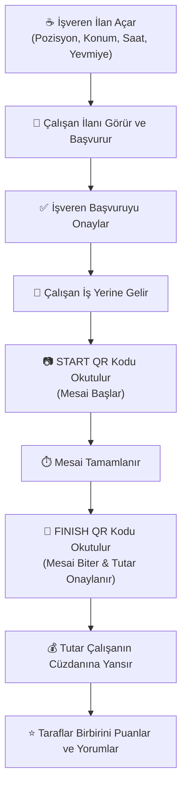

# ☕ Yömyeci — Emeğin ve Güvenin Dijital Buluşma Noktası

> *"Hafta sonu kafede acil bir baristaya mı ihtiyaç var? Ya da okuldan sonra birkaç saat çalışıp harçlığını çıkarmak isteyen bir genç misin? Yömyeci, tam olarak bu iki dünyayı en samimi, en şeffaf ve en pratik yoldan bir araya getirmek için var."*

Merhaba! 👋 **Yömyeci** projesine hoş geldin.  
Burası; aradaki karmaşık süreçleri, güvensizlikleri ve kağıt-kalem hesabını bir kenara bırakıp, günlük/yevmiyeli iş arayanlar ile dinamik işletmeleri tek bir çatı altında buluşturan samimi bir topluluk uygulamasıdır.

---

## 💡 Neden Yömyeci? (Hikayemiz)

Hepimiz biliyoruz: Hizmet sektöründe işler bir anda yoğunlaşır; bazen beklenmedik bir rezervasyon patlaması olur, bazen bir ekip arkadaşımız rahatsızlanır. İşletmeci o gün kapıyı kapatamaz; canla başla çalışacak bir dosta ihtiyaç duyar.  
Öte yandan; sınavlarından fırsat buldukça çalışmak isteyen üniversiteliler, mesleki deneyimini paraya dönüştürmek isteyen ustalar ve esnek saatlerle hayatını kazanmak isteyen yevmiyeciler var.

**Yömyeci**, bu iki tarafı birbirine güvenle bağlamak için tasarlandı:
- **Kağıt-kalem yok:** Mesainin başlangıcı ve bitişi birer QR kod okutması kadar net.
- **Soru işareti yok:** Kiminle çalışacağını önceki değerlendirmelerden ve puanlardan bilirsin.
- **Sürpriz yok:** Ücret, saatler, konum ve şartlar en baştan bellidir.

---

## ✨ Neler Sunuyoruz?

### 👔 İşverenler İçin
- **Dakikalar İçinde İlan:** Ankara'nın istediğin ilçesinde, ihtiyacın olan pozisyon için (Garson, Barista, Komi, Kasiyer, Temizlik vb.) anında ilan ver.
- **Başvuru Yönetimi:** Başvuran adayların profillerini, geçmiş deneyimlerini ve puanlarını incele; tek dokunuşla kabul et veya geri çevir.
- **Karekodla Mesai Kontrolü:** Çalışan dükkana adım attığında **Giriş QR Kodu (START)**, işini bitirip vedalaşırken **Çıkış QR Kodu (FINISH)** okutulsun. Her şey dijital ve anlık doğrulansın.
- **Çalışanı Değerlendir:** Günün sonunda çalışanın performansına yıldız ver, samimi bir yorum bırak.

### 🎒 Çalışanlar / Yömyeciler İçin
- **Sana En Yakın İlanlar:** Konumuna ve uzmanlığına uygun işleri listele, ilçelere göre filtrele.
- **Tek Tıkla Başvuru:** İlgilendiğin işe anında başvur, kabul edildiğin anda bildirim ekranında gör.
- **Karekod ile Güvenli Mesai:** "Kaçta başladım, kaçta çıktım?" derdi bitti. Telefonunla QR kodu okut, mesaini kendin başlat ve bitir.
- **Şeffaf Cüzdan ve Kazanç Takibi:** Kazandığın yevmiyeleri, tamamlanan işlerini ve cüzdan bakiyeni her an profilinden takip et.
- **İşvereni Puanla:** Çalışma ortamını, işletmenin yaklaşımını puanla; topluluğun güvenli kalmasına sen de katkı sun.

### 🎨 Deneyimi Güzelleştiren Detaylar
- **Gece / Gündüz Teması (Dark & Light Mode):** İster sabahın erken ışıklarında, ister gece vardiyasında ol; gözünü yormayan dinamik tema geçişi.
- **Akıllı Ağ Bağlantısı:** Sunucu IP adresini otomatik keşfeden ve yerel geliştirme ortamında hayatı kolaylaştıran altyapı.
- **Hızlı Giriş (Demo Dostu):** Geliştirme ve jüri sunumlarında tek tıkla test kullanıcısı olabilme kolaylığı.

---

## 🔄 Bir Günlük Mesai Nasıl İşler?



---

## 🛠️ Teknolojik Altyapı

Bu proje, hem hızlı geliştirilebilirlik hem de düşük sistem gereksinimi düşünülerek yalın ve güçlü teknolojilerle inşa edildi:

| Katman | Teknoloji / Kütüphane | Ne İşe Yarar? |
| :--- | :--- | :--- |
| **Mobil Uygulama** | **Flutter (Dart 3.x)** | iOS, Android ve Masaüstü için ortak, akıcı ve modern kullanıcı deneyimi. |
| **Durum & Saklama** | **SharedPreferences** | Kullanıcı oturumu, rol ve yerel tercihlerin güvenli tutulması. |
| **Kamera & QR** | **mobile_scanner & qr_flutter** | Işık hızında QR kod üretimi ve kamera okuması. |
| **Sunucu (Backend)** | **PHP 8+ (PDO, REST API)** | Hafif, hızlı ve yapılandırması kolay arka uç servisleri. |
| **Veritabanı** | **MySQL / MariaDB (utf8mb4)** | İlişkisel, Türkçe karakter dostu veri mimarisi. |
| **Test Kolaylaştırıcı**| **ADB Port Tunneling & Seeder** | Gerçek cihazlarda ve emülatörde sıfır eforla canlı test imkanı. |

---

## 🚀 Kurulum ve Çalıştırma Rehberi

Projeyi kendi bilgisayarında dakikalar içinde ayağa kaldırabilirsin. Çayını ya da kahveni al, adım adım ilerleyelim:

### 1. Ön Hazırlıklar
Bilgisayarında şunların kurulu olduğundan emin ol:
- [Flutter SDK](https://docs.flutter.dev/get-started/install) (3.x veya üzeri)
- [XAMPP](https://www.apachefriends.org/) (veya MAMP / yerel PHP + MySQL sunucusu)
- Git & VS Code / Android Studio

---

### 2. Backend (Sunucu) Kurulumu

1. Projedeki `backend/` klasörünü yerel web sunucunun kök dizinine (örneğin XAMPP için `C:\xampp\htdocs\backend`) kopyala veya sembolik bağ oluştur.
2. XAMPP Kontrol Panelinden **Apache** ve **MySQL** servislerini başlat.
3. Tarayıcından şu adrese giderek veritabanını ve örnek demo verilerini tek tıkla oluştur:
   ```text
   http://localhost/backend/seed.php
   ```
   > Ekranda `"Demo verileri basariyla yuklendi!"` mesajını gördüysen veritabanın, tabloların ve test kullanıcıların hazır demektir! 🎉

---

### 3. Mobil Uygulamanın Başlatılması

1. Bir terminal açıp proje ana dizinine gel:
   ```bash
   cd c:/Users/Emre/StudioProjects/okul_proje
   ```
2. Gerekli Flutter paketlerini indir:
   ```bash
   flutter pub get
   ```
3. Cihazını ya da emülatörünü seçip uygulamayı çalıştır:
   ```bash
   flutter run
   ```

---

### 4. 📱 İki Gerçek Telefonla Canlı Demo (Opsiyonel ama Çok Havalı!)

Eğer arkadaşınla veya jüri önünde iki farklı telefonla (biri işveren, diğeri çalışan) QR okutma senaryosunu canlandırmak istersen:

- **Seçenek A (USB Kablosu ile):**  
  Telefonunu bilgisayara bağla ve projenin kök dizinindeki `USB_TUNELI_AC.bat` dosyasını çift tıkla çalıştır. Bu betik, Android ADB ters tünelini kurarak telefonun doğrudan `localhost` üzerinden bilgisayardaki backend'e erişmesini sağlar.

- **Seçenek B (Aynı Wi-Fi Üzerinden):**  
  Bilgisayarın ve telefonların aynı Wi-Fi ağına bağlıyken, bilgisayarının yerel IP adresini (örn: `192.168.1.35`) uygulamanın giriş ekranındaki **Sunucu Ayarı** alanına yazman yeterlidir!

---

## 👥 Hazır Demo Kullanıcıları

Test ederken zaman kaybetmemen için `seed.php` içerisine iki adet hazır profil yerleştirdik:

| Rol | İsim | Telefon Numarası | Şifre | Açıklama |
| :--- | :--- | :--- | :--- | :--- |
| **İşveren** | Berkay Yılbat | `0544 507 35 25` | `123` | Gig Jet Organizasyon yöneticisi. Aktif ilanları ve onaylanmış işleri var. |
| **Çalışan** | Berat Taştekin | `0543 829 64 84` | `123` | Deneyimli barista & garson. Cüzdanında birikmiş yevmiyesi ve geçmiş işleri mevcut. |

*(İstersen kayıt ol ekranından saniyeler içinde yepyeni bir hesap da oluşturabilirsin.)*

---

## 📁 Proje Dizin Yapısı

Merak edenler için mutfağın yerleşim planı:

```text
okul_proje/
├── lib/
│   ├── main.dart                  # Uygulamanın giriş noktası ve tema sarmalayıcısı
│   ├── home_screen.dart           # Rol bazlı ana kontrol paneli (İlanlar / Profil / Geçmiş)
│   ├── jobs_list_screen.dart      # İlan listesi ve filtreleme arayüzü
│   ├── add_job_screen.dart        # İşveren için yeni ilan oluşturma formu
│   ├── applications_screen.dart   # Gelen / giden başvuruların yönetimi
│   ├── qr_generate_screen.dart    # İşe başlama ve bitirme için dinamik QR üretici
│   ├── qr_scan_screen.dart        # Kamera ile QR tarama ekranı
│   ├── auth_service.dart          # Kimlik doğrulama, oturum ve cüzdan API köprüsü
│   ├── job_service.dart           # İlan ve başvuru işlemleri servisi
│   ├── server_config.dart         # Akıllı yerel IP ve sunucu adresi yönetimi
│   ├── theme/                     # Açık ve koyu tema tanımları
│   └── widgets/                   # Özel butonlar, dialoglar, telefon formatlayıcı vb.
│
├── backend/                       # PHP REST API Dosyaları
│   ├── db.php                     # Güvenli PDO veritabanı bağlantısı ve sanitization
│   ├── seed.php                   # Tabloları kuran ve test verisi basan sihirli dosya
│   ├── login.php / register.php   # Kullanıcı kimlik doğrulama uç noktaları
│   ├── get_jobs.php / add_job.php # İlan okuma ve oluşturma servisleri
│   ├── check_status.php           # QR durumunu dinleyen anlık yoklama (polling)
│   └── submit_review.php          # Karşılıklı puan ve yorum kayıt servisi
│
├── assets/                        # Uygulama ikonları ve görsel materyaller
└── USB_TUNELI_AC.bat              # Canlı sunumlar için tek tıkla USB tünel yardımcısı
```

---

## 💡 Gelecek Vizyonumuz (Yol Haritası)

- [ ] **Anlık Push Bildirimler:** Bir başvuru geldiğinde veya onaylandığında telefona titreşimli anlık bildirim gönderme.
- [ ] **Harita Üzerinde Keşfet:** İlanları haritada pinler halinde görerek yol tarifini tek tuşla alma.
- [ ] **Uygulama İçi Sohbet:** Mesai öncesi işveren ve çalışanın uygulama içinden hızlıca mesajlaşabilmesi.
- [ ] **Entegre Ödeme Geçidi:** Yevmiyelerin otomatik banka transferi ile hesaba aktarılması.

---

## 🤝 Katkıda Bulunmak İster misin?

Bu proje bir fikirle, bir fincan kahveyle ve öğrenme tutkusuyla başladı.  
Her türlü fikre, geri bildirime ve `Pull Request`'e kapımız sonuna kadar açık:

1. Bu depoyu çatalla (Fork).
2. Özellik dalını oluştur (`git checkout -b ozellik/harika-bir-fikir`).
3. Değişikliklerini kaydet (`git commit -m 'feat: Harika bir özellik eklendi'`).
4. Dalına gönder (`git push origin ozellik/harika-bir-fikir`).
5. Bir **Pull Request** aç, birlikte inceleyelim!

---

<p align="center">
  <b>Yömyeci</b> — <i>Emeğin değer bulduğu, güvenin inşa edildiği yer.</i><br/>
  Sevgiyle ve bir sürü kahveyle geliştirildi. ❤️☕
</p>
